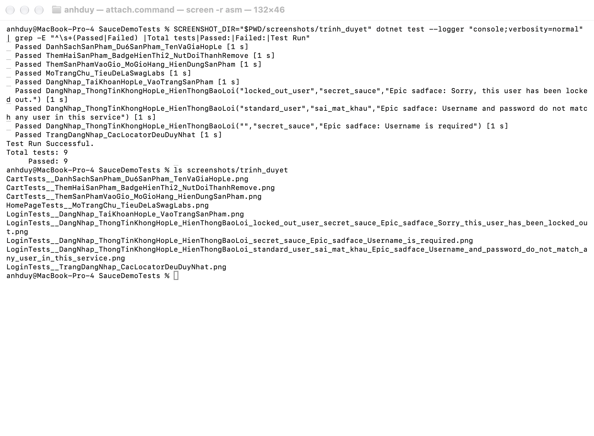
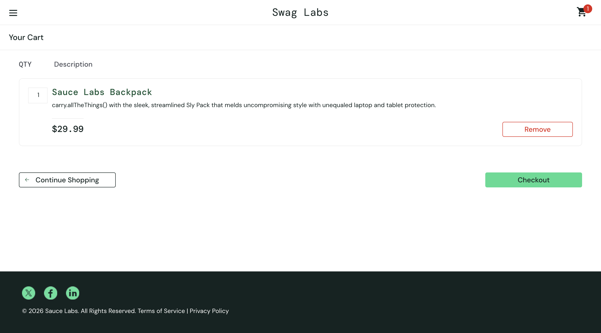

# SauceDemoTests — Framework kiểm thử tự động (Selenium + NUnit, .NET 10)

Assignment môn **SOF3091 – Kiểm thử nâng cao cùng AI (.NET)**, FPT Polytechnic.
Đối tượng kiểm thử: <https://www.saucedemo.com/> (trang demo công khai, được phép kiểm thử).

> Trạng thái: **Giai đoạn 1 – hoàn thành Y1 và Y2** (9/9 test xanh).
> Các yêu cầu Y3–Y10 (chờ tường minh, POM, data-driven, báo cáo, AI, PR, CI, README hoàn chỉnh) làm ở các giai đoạn sau.

## Công nghệ

| Thành phần | Phiên bản |
|---|---|
| .NET SDK | 10.0.404 (net10.0) |
| NUnit / NUnit3TestAdapter | 4.3.2 / 5.0.0 |
| Selenium.WebDriver | 4.54.0 (Selenium Manager tự tải ChromeDriver) |
| Trình duyệt | Google Chrome 157 |
| Quản lý mã nguồn | Git, Conventional Commits |

## Cấu trúc thư mục

```
SauceDemoTests/
├── SauceDemoTests.csproj
├── Tests/
│   ├── TestBase.cs        # mở/đóng Chrome, DangNhap(), ChoUrlChua(), ChoPhanTuHienThi()
│   ├── HomePageTests.cs   # Y1: kiểm tra tiêu đề trang
│   ├── LoginTests.cs      # Y2: đăng nhập thuận + nghịch, kiểm chứng locator
│   └── CartTests.cs       # Y2 nâng cao: danh sách sản phẩm, thêm vào giỏ, mở giỏ
└── screenshots/           # ảnh minh chứng (Terminal + trang web cuối mỗi test)
```

## Ảnh minh họa

| Kết quả `dotnet test` (9/9 xanh) | Giỏ hàng sau khi thêm Backpack |
|---|---|
|  |  |

## Cách chạy

Yêu cầu: đã cài .NET SDK 10 và Google Chrome.

```bash
git clone <link-repo>
cd SauceDemoTests
dotnet build
dotnet test
```

Xem tên từng test khi chạy:

```bash
dotnet test --logger "console;verbosity=normal"
```

Chạy ẩn trình duyệt (headless):

```bash
HEADLESS=true dotnet test            # macOS / Linux
$env:HEADLESS="true"; dotnet test    # Windows PowerShell
```

Lưu ảnh trang web ở cuối mỗi test (dùng làm minh chứng) — truyền **đường dẫn tuyệt đối**,
vì `dotnet test` chạy trong thư mục `bin/Debug/net10.0`:

```bash
SCREENSHOT_DIR="$PWD/screenshots/trinh_duyet" dotnet test                        # macOS / Linux
$env:SCREENSHOT_DIR="$PWD\screenshots\trinh_duyet"; dotnet test                  # Windows PowerShell
```

> Lần đầu chạy, Selenium Manager tự tải ChromeDriver khớp với phiên bản Chrome trên máy, nên cần có mạng.

## Danh sách test (giai đoạn 1)

| Lớp | Test | Mục đích |
|---|---|---|
| HomePageTests | `MoTrangChu_TieuDeLaSwagLabs` | Y1 – mở saucedemo, tiêu đề = "Swag Labs" |
| LoginTests | `DangNhap_TaiKhoanHopLe_VaoTrangSanPham` | Y2 – đăng nhập `standard_user`, vào `inventory.html`, có 6 sản phẩm |
| LoginTests | `DangNhap_ThongTinKhongHopLe_HienThongBaoLoi` (3 ca) | Y2 – tài khoản bị khóa, sai mật khẩu, bỏ trống username |
| LoginTests | `TrangDangNhap_CacLocatorDeuDuyNhat` | Y2 – mỗi locator khớp đúng 1 phần tử |
| CartTests | `DanhSachSanPham_Du6SanPham_TenVaGiaHopLe` | Y2 – đọc tên/giá bên trong từng thẻ sản phẩm |
| CartTests | `ThemSanPhamVaoGio_MoGioHang_HienDungSanPham` | Y2 nâng cao – thêm Backpack, mở giỏ, đối chiếu tên/giá/số lượng |
| CartTests | `ThemHaiSanPham_BadgeHienThi2_NutDoiThanhRemove` | Y2 nâng cao – badge giỏ = 2, nút đổi thành Remove |

## Bảng locator

Chỉ dùng `id` và `data-test`; không dùng XPath tuyệt đối.

| Phần tử | Locator dùng | Phương án khác | Lý do chọn |
|---|---|---|---|
| Ô Username | `By.Id("user-name")` | `[data-test='username']` | id duy nhất, nhanh nhất |
| Ô Password | `By.Id("password")` | `[data-test='password']` | id duy nhất |
| Nút Login | `By.Id("login-button")` | `[data-test='login-button']` | id duy nhất |
| Thông báo lỗi | `[data-test='error']` | `.error-message-container h3` | không có id; data-test dành riêng cho test |
| Tiêu đề trang | `[data-test='title']` | `.title` | class dùng cho CSS, dễ đổi |
| Thẻ sản phẩm | `[data-test='inventory-item']` | `.inventory_item` | dùng với `FindElements` |
| Tên / giá sản phẩm | `[data-test='inventory-item-name']` / `[data-test='inventory-item-price']` | `.inventory_item_name` / `.inventory_item_price` | tìm bên trong từng thẻ bằng `item.FindElement` |
| Nút Add to cart | `[data-test='add-to-cart-sauce-labs-backpack']` | `#add-to-cart-sauce-labs-backpack` | gắn với sản phẩm cụ thể |
| Badge giỏ hàng | `[data-test='shopping-cart-badge']` | `.shopping_cart_badge` | data-test ổn định |
| Biểu tượng giỏ | `[data-test='shopping-cart-link']` | `.shopping_cart_link` | data-test ổn định |

## Quy ước commit

Theo Conventional Commits: `feat:`, `build:`, `test:`, `refactor:`, `docs:`.
Mỗi tính năng làm trên một nhánh `feature/...`, chạy xanh rồi mới merge vào `main`.

## Nhóm thực hiện

Lương Công Trường (PS48775) · Nguyễn Thái Minh Tín (PS48989) · Lê Đăng Hải (PS48830) ·
Nguyễn Đăng Khoa (PS48883) · Nguyễn Anh Duy (PS48450) · Phạm Minh Triết (PS48509)
